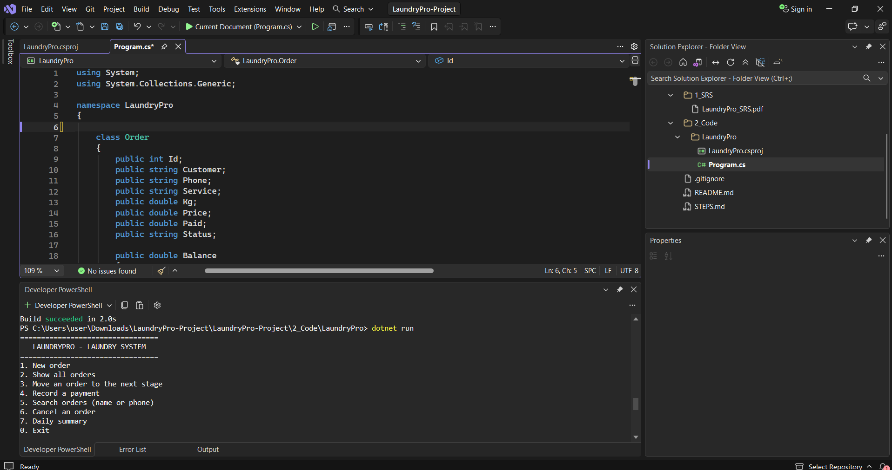
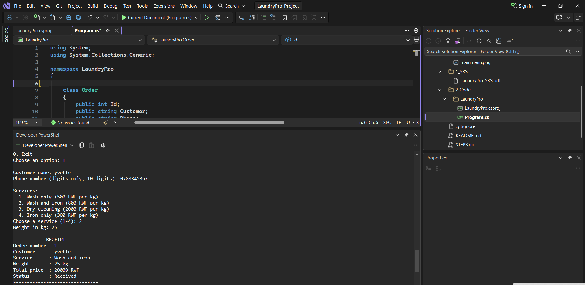
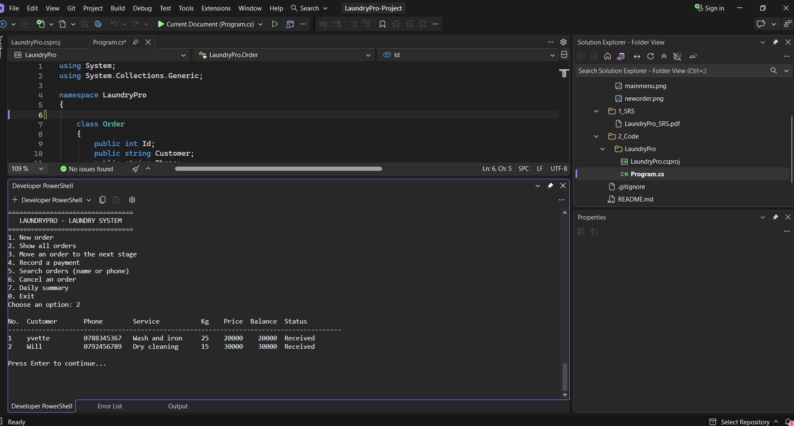
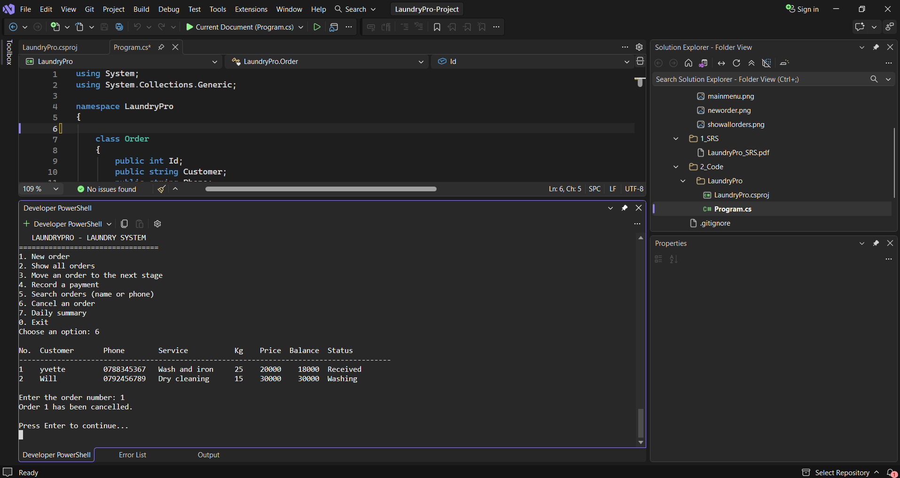
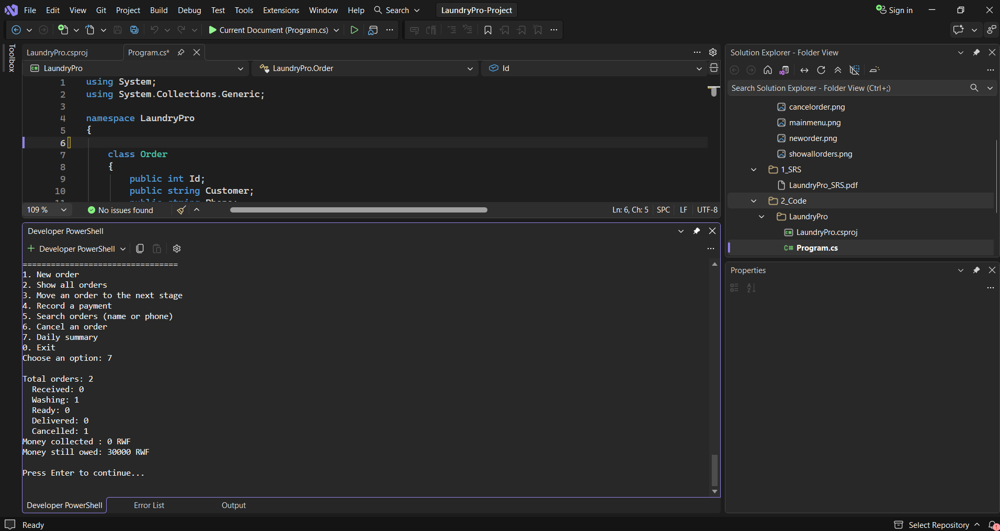

# LaundryPro: Laundry Service Management System

**Student:** Isimbi Mushimire Iris  
**Student ID:** 27121  
**Programme:** Software Engineering, Adventist University of Central Africa (AUCA)

---

## 1. Project Description

LaundryPro helps a small laundry shop register customer orders, calculate prices automatically, track each order from reception to delivery, record payments, and see a daily summary.

It replaces the paper notebook that many shops use.

The full Software Requirements Specification is available here: [LaundryPro SRS](../../1_SRS/LaundryPro_SRS.pdf).

## 2. Environment

- **Operating System:** Windows
- **IDE:** Visual Studio
- **Language and Platform:** C# on .NET 10
- **Application Type:** Console Application

## 3. Project Structure

```text
LaundryPro-Project/
│
├── 1_SRS/
│   └── LaundryPro_SRS.pdf
│
├── 2_Code/
│   └── LaundryPro/
│       ├── Program.cs
│       ├── LaundryPro.csproj
│       └── README.md
│
├── screenshots/
│   ├── mainmenu.png
│   ├── neworder.png
│   ├── showallorders.png
│   ├── cancelorder.png
│   └── dailysummary.png
│
└── .gitignore
```

## 4. Features of the Prototype

| Option | Function |
|---|---|
| 1 | New order (name, 10-digit phone, service, weight) with automatic price and receipt |
| 2 | Show all orders with balance and status |
| 3 | Move an order to the next stage: Received, Washing, Ready, Delivered |
| 4 | Record a full or partial payment |
| 5 | Search orders by customer name or phone number |
| 6 | Cancel an order (only while it is still Received) |
| 7 | Daily summary: orders per status, money collected, money still owed |
| 0 | Exit |

**Business Rules:**

- Stages cannot be skipped.
- An order cannot be delivered until it is fully paid.
- All input is validated.

**Prices per kg:**

| Service | Price |
|---|---:|
| Wash only | 500 RWF |
| Wash and iron | 800 RWF |
| Dry cleaning | 2,000 RWF |
| Iron only | 300 RWF |

## 5. How to Run

1. Open the `2_Code/LaundryPro` folder in Visual Studio.
2. Open Developer PowerShell (View → Terminal).
3. Run the following commands:

```powershell
dotnet restore
dotnet run
```

4. Type the number of an option and press Enter.

## 6. Screenshots

### 6.1 Main Menu



[View Main Menu Screenshot](screenshots/mainmenu.png)

---

### 6.2 New Order and Receipt



[View New Order Screenshot](screenshots/neworder.png)

---

### 6.3 All Orders



[View All Orders Screenshot](screenshots/showallorders.png)

---

### 6.4 Cancel Order



[View Cancel Order Screenshot](screenshots/cancelorder.png)

---

### 6.5 Daily Summary



[View Daily Summary Screenshot](screenshots/dailysummary.png)

---

## 7. Conclusion

The prototype uses an `Order` class, a `List<Order>`, arrays for services and stages, methods for each menu option, and `TryParse` validation so that wrong input does not crash the program.

Data is kept in memory only. A future version can save orders in a database or file.